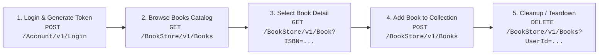

# Performance Test JMeter - DemoQA Book Store Application

Repositori ini berisi artefak lengkap untuk pengujian performa (**Performance & Load Testing**) pada aplikasi web dan REST API **DemoQA Book Store** (`https://demoqa.com/login`), dirancang menggunakan **Apache JMeter 5.6+** sesuai standar *Performance Engineering*.

---

## 1. Arsitektur & End-to-End Flow

Alur pengujian mensimulasikan perjalanan pengguna nyata (*User Journey*):



### Korelasi & Ekstraksi Data (*Correlation*)
- **`token` & `userId`**: Diekstrak dari respon `POST /Account/v1/Login` menggunakan **JSON Extractor** (`$.token` dan `$.userId`), kemudian dipassing otomatis ke header `Authorization: Bearer ${token}` dan body `Add Book` serta parameter query `Cleanup`.
- **`ISBN`**: Diekstrak secara dinamis dari respons katalog `GET /BookStore/v1/Books` menggunakan **JSON Extractor** (`$.books[*].isbn` dengan `Match No = 0` / Random) untuk dipakai di request `Select Book` dan `Add Book`.
- **`Cleanup (DELETE)`**: Dilakukan di akhir setiap siklus user untuk memastikan tidak terjadi error `400 Bad Request: ISBN already present in the User's Collection!` pada iterasi berikutnya.

---

## 2. Matriks Skenario Pengujian

| No | Skenario | Load (Users) | Ramp-Up | Durasi / Loop | Tujuan Pengujian |
|:--:|---|:---:|:---:|:---:|---|
| **1** | **Baseline** | 1 user | 1s | 5 iterasi | Validasi kelancaran skrip, assertion, dan baseline response time murni |
| **2** | **Load Test** | 10 users | 20s (2s/user) | 300s (5 min) | Semua user menyelesaikan flow; mengukur RT, throughput (TPS), & error rate |
| **3** | **Load Test** | 50 users | 50s (1s/user) | 600s (10 min) | Stabilitas sistem; identifikasi tanda degradasi awal |
| **4** | **Load Test** | 100 users | 100s (1s/user) | 600s (10 min) | Kapasitas 100 concurrent users; analisis failed requests / bottlenecks |
| **5** | **Ramp-Up / Stress** | 100 users | 60s (Agresif) | 300s (5 min) | Tren response time terhadap lonjakan cepat; titik degradasi |
| **6** | **Soak Test** | 25 users (25% peak) | 60s | 1800s (30 min) | Deteksi potensi memory leak dan degradasi performa bertahap |

> Rincian justifikasi pemilihan Thread Count, Ramp-Up, dan Durasi dapat dibaca pada dokumen [docs/thread_group_rationale.md](docs/thread_group_rationale.md).

---

## 3. Struktur Direktori Proyek

```text
├── data/
│   ├── users.csv                     # Parameterisasi 100 virtual users unik
│   └── books.csv                     # Referensi dataset ISBN buku
├── docs/
│   └── thread_group_rationale.md     # Penjelasan teknis alasan pemilihan parameter
├── reports/                          # Direktori hasil uji (JTL & HTML Dashboard)
│   ├── baseline/
│   ├── load_10/
│   ├── load_50/
│   └── load_100/
├── scripts/
│   ├── BookStore_Master_TestPlan.jmx # Master Test Plan (Modular: Test Fragment + Module Controllers)
│   ├── register_users.ps1            # Helper pra-registrasi via PowerShell (Windows native)
│   ├── register_users.py             # Helper pra-registrasi via Python
│   ├── register_users.jmx            # Helper pra-registrasi via JMeter
│   └── scenarios/
│       └── 01_Baseline_1User.jmx     # File JMX mandiri untuk Baseline Test
├── .gitignore
└── README.md
```

---

## 4. Komponen Teknis yang Diterapkan

1. **HTTP Request Defaults**: Domain `demoqa.com`, protokol `https`, port `443`, timeout connect `10s`, response `30s`, implementasi `HttpClient4`.
2. **HTTP Header Manager**: `Content-Type: application/json`, `Accept: application/json`, dan `Authorization: Bearer ${token}`.
3. **HTTP Cookie Manager**: `clearEachIteration = true`.
4. **CSV Data Set Config**: Membaca kredensial user unik dari `data/users.csv`. Password memenuhi standar keamanan (`P@ssw0rd2026!`: >= 8 karakter, huruf besar, huruf kecil, angka, dan karakter spesial).
5. **Transaction Controller**: Membungkus setiap step transaksi (`TC_01_Login`, `TC_02_BrowseBooks`, `TC_03_SelectBook`, `TC_04_AddBook`, `TC_05_Cleanup`) dengan opsi *Generate parent sample* aktif untuk pelaporan Response Time per langkah bisnis.
6. **Timers (Gaussian Random Timer)**: Memberikan think time realistis (1.5s – 2.0s ± 500ms) di antara aksi pengguna.
7. **Assertions**:
   - **Login**: Response Code `200` + JSON Assertion `$.token` & `$.userId` tidak kosong.
   - **Browse**: Response Code `200` + JSON Assertion `$.books` ada.
   - **Select**: Response Code `200` + JSON Assertion `$.isbn` cocok dengan ISBN yang dipilih.
   - **Add Book**: Response Code `201 Created` + JSON Assertion ISBN ada di dalam respon array `$.books[*].isbn`.
   - **Cleanup**: Response Code `200` atau `204`.
8. **Listeners**: Summary Report dan Aggregate Report.

---

## 5. Panduan Menjalankan Pengujian

### Langkah 1: Persiapan Akun Pengguna (Pilih Salah Satu)
Sebelum menjalankan pengujian, pastikan akun virtual user sudah terdaftar di DemoQA:

- **Opsi A: Menggunakan PowerShell (Rekomendasi di Windows - Tanpa Install Apapun)**
  ```powershell
  # Dari root direktori proyek:
  .\scripts\register_users.ps1
  ```

- **Opsi B: Menggunakan JMeter Langsung (Native JMX)**
  ```bash
  # Dari root direktori proyek:
  jmeter -n -t scripts/register_users.jmx -l reports/register_users.jtl
  ```

- **Opsi C: Menggunakan Python** (Jika Python sudah terinstal di sistem)
  ```bash
  # Dari root direktori proyek:
  python scripts/register_users.py
  ```

### Langkah 2: Menjalankan Baseline Test via CLI (Non-GUI Mode)
Jalankan pengujian menggunakan CLI JMeter untuk efisiensi resource:
```bash
# Dari root direktori proyek:
jmeter -n -t scripts/scenarios/01_Baseline_1User.jmx -l reports/baseline/results.jtl -e -o reports/baseline/dashboard/
```

### Langkah 3: Menjalankan Master Test Plan untuk Skenario Lain
Pada file `scripts/BookStore_Master_TestPlan.jmx`:
- Buka di JMeter GUI (`jmeter.bat`), klik kanan pada Thread Group skenario yang ingin dijalankan (misal `Scenario_02_LoadTest_10Users`), pilih **Enable**, lalu nonaktifkan skenario lainnya.
- Atau jalankan langsung via command line:
```bash
jmeter -n -t scripts/BookStore_Master_TestPlan.jmx -l reports/load_10/results.jtl -e -o reports/load_10/dashboard/
```

---

## 6. Panduan Upload ke GitHub

Inisialisasi git dan upload ke repository GitHub Anda dengan perintah berikut:

```bash
git init
git add .
git commit -m "feat: complete JMeter performance test suite for DemoQA BookStore"
git branch -M main
git remote add origin https://github.com/<username-anda>/<nama-repo-anda>.git
git push -u origin main
```
